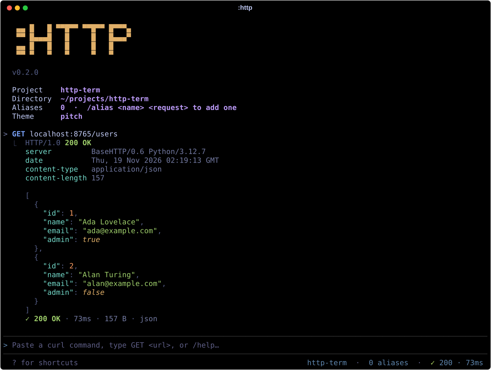

# :http



**A calm, beautiful terminal client for HTTP requests.** :sql's look — the pixel wordmark, the input between two rules, a one-line footer with `? for shortcuts` and vi's `-- INSERT --` — built around sending requests and reading responses.

- **Paste curl, or don't.** `curl -X GET https://api.dev/users` works as-is, and so does `GET api.dev/users`.
- **Readable responses.** Status, headers and a re-indented, highlighted body (JSON, HTML, XML, YAML…) under a `⎿`, with a status line for status, time, size and type.
- **Aliases per project.** `/alias get_all_users GET api.dev/users`, then just `/get_all_users`. Each git repository has its own aliases.
- **Keys you know.** vi or emacs bindings, history with search, completion for commands, aliases, methods and flags.

## Install

```sh
curl -fsSL https://raw.githubusercontent.com/arthurdaquinosilva/http-term/main/install.sh | sh
```

The script downloads :http from GitHub into its own virtual environment (`~/.local/share/http-term/venv`) and links the `:http` command into `~/.local/bin`, telling you if that isn't on your `PATH`. Run it again to upgrade to the latest code on `main`. Other options:

```sh
curl -fsSL .../install.sh | sh -s -- 0.2.0          # a specific release
curl -fsSL .../install.sh | sh -s -- --uninstall    # remove it (config and aliases are kept)
```

:http isn't on PyPI; GitHub is the only place it's published. Requires Python 3.10+ on macOS or Linux.

## Quick tour

```text
> curl -X GET https://someendpoint.com/users/        paste any curl command
> GET api.dev/users                                  or a method and a URL (https assumed)
> POST :8000/login username='arthur' password='1234'  fields after the URL become a JSON body
> PUT :8000/users/1 age:=33 admin:=true              := sends raw JSON (numbers, booleans, lists…)
> GET api.dev/search q=='hello world' X-Token:abc    == adds a query parameter, Name:value a header
> POST :8000/users -d '{"name": "ada"}'              :port means localhost; -d JSON bodies go as JSON
> GET api.dev/me -H 'Authorization: Bearer $TOKEN'   $VARS come from your environment

> /alias get_all_users curl -X GET https://someendpoint.com/users/
> /get_all_users
> /alias get_user GET api.dev/users/{id}             {placeholders} are filled when called
> /get_user 42                                       or /get_user id=42; extra args are appended (-v, -H …)
> /alias create_user POST api.dev/users
> /create_user name=ada age:=36                      so fields can be passed to an alias too
> /save health                                       save the last request as /health
> /aliases                                           list this project's aliases
```

| Command | |
| --- | --- |
| `/alias <name> <request>` | save a request (`/alias <name>` shows it) |
| `/save <name>` | save the last request |
| `/aliases` · `/unalias <name>` · `/edit <name>` | list · delete · load into the input to change |
| `/body` · `/write <file>` | read the whole last response in a pager · save its body |
| `/headers [on\|off]` · `/theme <name>` · `/mode vi\|emacs` | display settings |
| `/project` · `/clear` · `/help` · `/exit` | |

Supported curl options: `-X -H -d --data-raw --data-binary --data-urlencode --json -u -A -e -b -m -L -k -I -G -v --url`. Cosmetic ones (`-s -S -i -f --compressed`…) are accepted and ignored. Multipart forms (`-F`) aren't supported yet.

## Projects

A project is the git repository you're in, or the current directory outside one (`--project DIR` picks another). Its aliases and input history live in `~/.local/share/http-term/projects/<name>-<hash>/`, never inside the repo. `/project` shows where. Aliases are stored exactly as typed, so `$TOKEN` stays a reference rather than becoming a saved secret.

## Command line

```sh
:http                              # interactive
:http --vi                         # vi keys
:http GET api.dev/users            # send one request and exit (status 1 on errors or 4xx/5xx)
:http /get_all_users | jq .        # piped output is the bare response body
```

## Configuration

`~/.config/http-term/config.toml`:

```toml
theme = "pitch"        # the only theme for now
editing_mode = "vi"    # or emacs
headers = true         # show response headers
timeout = 30           # seconds
max_lines = 300        # longer bodies are cut; /body shows everything
```

## Development

Releases are tagged on GitHub; see [docs/releasing.md](https://github.com/arthurdaquinosilva/http-term/blob/main/docs/releasing.md).

```sh
python -m venv .venv && .venv/bin/pip install -e '.[dev]'
.venv/bin/python -m pytest
docker build -t http-term . && docker run --rm http-term   # lint + tests in a container
.venv/bin/python scripts/screenshot.py                  # re-record docs/assets/cover.svg
```
